# InspectAgent

**Zero-shot casting inspection on a phone, built with Meta's SAM 3.1 and Muse Spark.**

Small foundries and pump makers, like the ones around Coimbatore, still check castings by eye. Machine vision would help, but it needs thousands of labelled defect photos plus expensive integration, so most of these factories never adopt it. InspectAgent works from the first part with **no labelled data**. You describe defects in plain words, and the factory's own acceptance rules decide the verdict.

> Track: **Push the Frontier** (manufacturing)

| | |
|---|---|
| **Find** | **SAM 3.1** segments every region matching a plain-word prompt: `porosity`, `crack`, `burr`, `scratch`, or any new term you type. |
| **Measure** | Each mask is converted to millimetres using the part's known diameter. The system records the zone (hub, vane, rim, edge), the clock position, the largest pore, and the burr height. |
| **Judge** | **Muse Spark** reads the annotated photo, the measurements, the part's rules and similar engineer-reviewed examples. It returns a plain-English verdict, e.g. *"Fail. 3.3 mm pore in the vane area at 4 o'clock exceeds the 2 mm limit."* |
| **Explain** | A **Muse Spark tool-calling agent** queries production history by furnace, shift, supplier and heat. It finds hot spots such as *"Furnace 2 on night shift: 3.5× the porosity rate, 39% of all porosity defects"* and drafts an **8D/CAPA report** (PDF). |
| **Learn** | "Confirm defect" and "Not a defect" build a per-part library. Look-alikes of rejected detections are held for review, and after repeated rejections they are treated as false positives. Confirmed examples become few-shot evidence for Muse Spark. |
| **Talk** | **Muse Voice Transcribe** turns an operator's spoken note into text attached to the inspection. |

## Quick start

```bash
cp .env.example .env          # optional: add MODEL_API_KEY from dev.meta.ai
make setup                    # Python venv + npm install + seed demo data
make dev                      # API on :8000, web app on :3000
```

Open http://localhost:3000. To use the camera on a phone, run `make web-https` and open `https://<your-LAN-ip>:3000`.

**No key? It still runs end to end.** Without `MODEL_API_KEY`, InspectAgent uses an offline path:
- An OpenCV segmenter stands in for SAM 3.1.
- A deterministic rule engine stands in for Muse Spark.
- A scripted analyst runs the same root-cause tools.

The sidebar shows which mode is active. Add a key and restart the API to switch to the Meta models. If a Meta call fails mid-shift, the line keeps running on the offline path and the UI shows a warning.

## Architecture

```mermaid
flowchart LR
  subgraph Phone / line camera
    UI[Next.js PWA<br/>Inspect · Line · Dashboard<br/>Root cause · Library · Rules]
  end
  UI -- photo + prompts + furnace/shift/heat --> API[FastAPI]
  API -- "noun-phrase prompts" --> SAM[SAM 3.1<br/>/v1/responses]
  SAM -- boxes + one_bit masks --> DEC[Mask decoder<br/>Python port of @meta-sam/parser]
  DEC --> MEAS[Measure<br/>px→mm, zone, pore size]
  MEAS --> RULES[Rule engine<br/>part acceptance rules]
  LIB[(Defect library<br/>confirmed / rejected)] --> RULES
  RULES -- draft + annotated photo --> SPARK[Muse Spark<br/>structured JSON verdict]
  SPARK --> DB[(SQLite<br/>inspections + defects)]
  DB --> AGENT[Root-cause agent<br/>Muse Spark tool calling]
  AGENT -- trend · rate_by · rate_by_pair · defect_profile --> DB
  AGENT --> PDF[8D / CAPA PDF]
  UI -- voice note WAV --> ASR[Muse Voice Transcribe<br/>/v1/asr/transcribe]
```



Design choices:
- **Muse Spark reasons, but the rules are binding.** The deterministic rule engine always runs. Muse Spark can downgrade a detection it thinks is a false positive (a shadow, a sand grain, a designed hole). It cannot pass a confident, library-unchallenged violation of a reject limit.
- **Measurements are deterministic.** Sizes come from pixels and the part diameter, not from the language model.
- **The SAM 3.1 wire format is decoded in Python.** [sam_codec.py](api/app/providers/sam_codec.py) ports Meta's range-coded `one_bit` and `lossless` mask codecs. Tests decode Meta's published sample masks and round-trip the one_bit codec.

## Demo script (2 minutes)

1. **Inspect.** Tap the *Mixed defects* sample. SAM outlines a crack, porosity and a scratch, and the verdict appears: **FAIL**, *"Crack in the vane area at 4 o'clock: any crack is a reject."* Type `sand inclusion` into "Look for" to show a new defect class with zero training.
2. **Teach.** On a porosity detection, tap **Not a defect → "Sand grain on surface"** and press **Re-run**. That detection is now held for **REVIEW** instead of failing the part, because the system learned from one click.
3. **Dashboard.** A red banner reads *"Porosity hot spot: Furnace 2 on Shift C · Night, 3.5× the plant average."*
4. **Root cause.** Press **Find root cause**. The agent streams each query and result: weekly trend → zones → by furnace → by shift → by supplier → furnace × shift. It concludes Furnace 2 night-shift melt practice is the main cause, with **Supplier B** as a secondary contributor, and drafts the 8D. Press **Download PDF**.
5. **Rules.** Change *"Reject if any hole is bigger than 2 mm"* to 3 mm. The next inspection uses it immediately, with no retraining.
6. **Line mode.** Press **Start line** to show automatic inspection every few seconds, with a live yield gauge and ticker.

## Demo data

- **Sample photos:** procedurally rendered top-down pump-impeller castings ([synth.py](api/app/services/synth.py)) with injected porosity, cracks, burrs and scratches. Because the defect locations are known, they double as test ground truth. Run `make kaggle` to add real photos from the public Kaggle *casting product image data for quality inspection* set (needs a Kaggle token).
- **Production history:** six weeks of seeded inspections, about 8,300 castings across 3 furnaces × 3 shifts × 3 suppliers. It contains two planted signals for the agent to find: porosity concentrated on Furnace 2 night shift, and a Supplier B pig-iron batch that started three weeks ago. Live inspections join the same history.

## Project layout

```
api/   FastAPI · SQLAlchemy/SQLite · OpenCV · ReportLab
  app/providers/  meta.py (SAM 3.1, Muse Spark, Voice) · sam_codec.py · mock.py (offline)
  app/services/   pipeline · measure · judge · library · analytics · rootcause · report · synth
  tests/          codec, measurement, detector recall, rules, learning loop, root cause
web/   Next.js 15 · Tailwind v4 · Motion · Recharts (installable PWA)
data/  SQLite db, uploads, samples
```

| Endpoint | |
|---|---|
| `POST /api/inspect` | multipart image + `part_id`, `prompts`, `machine`, `shift`, `batch`, `supplier` |
| `POST /api/defects/{id}/review` | `{status: confirmed \| rejected \| pending, feedback}` |
| `GET /api/rootcause/stream` | SSE agent trace and 8D report |
| `POST /api/reports/8d/pdf` | 8D JSON → PDF |
| `GET /api/analytics/overview` | KPIs, Pareto, daily series, furnace × shift heatmap, hot spot |
| `GET/PUT /api/parts/{id}` | prompts and acceptance rules |
| `POST /api/voice` | WAV → text (Muse Voice Transcribe) |

```bash
make test   # 11 backend tests
make lint   # tsc + eslint
```
